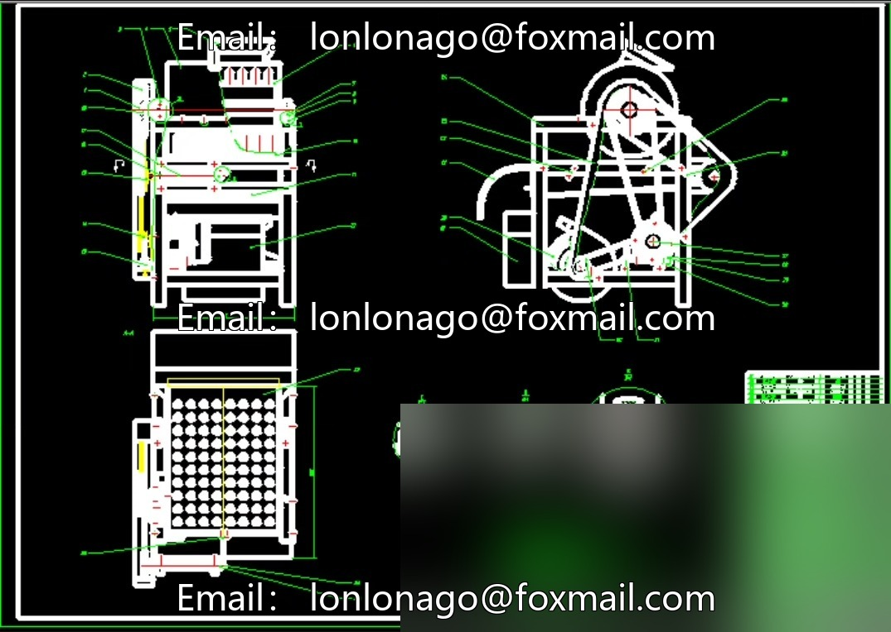
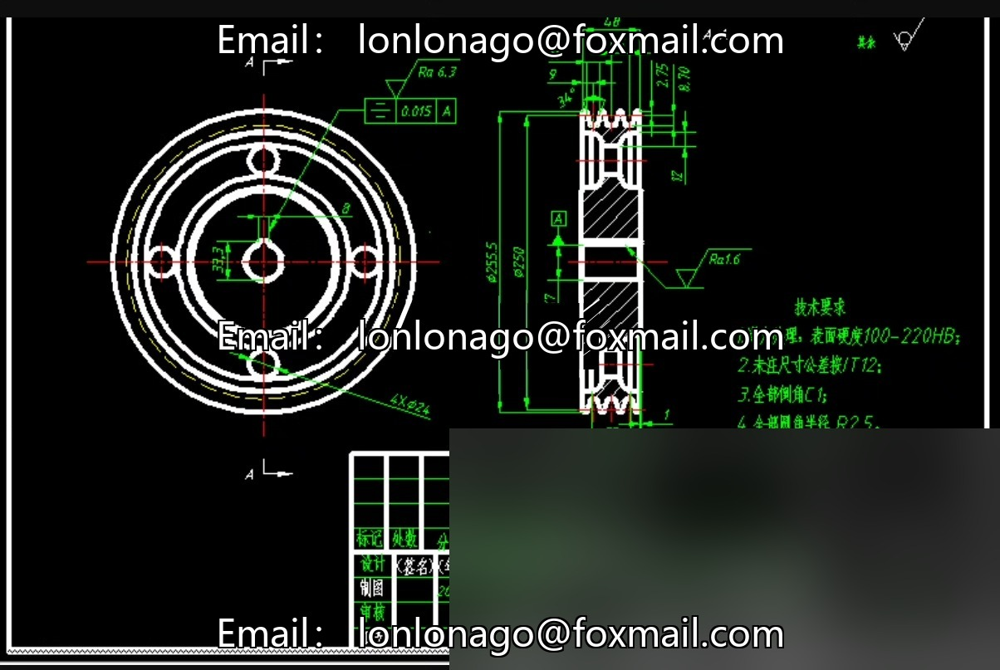
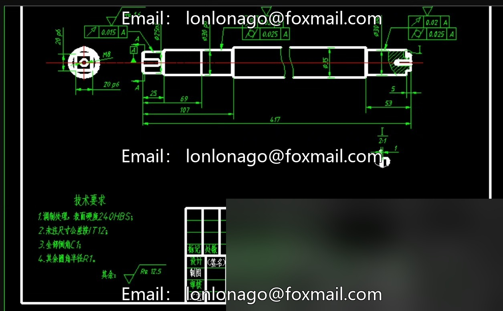
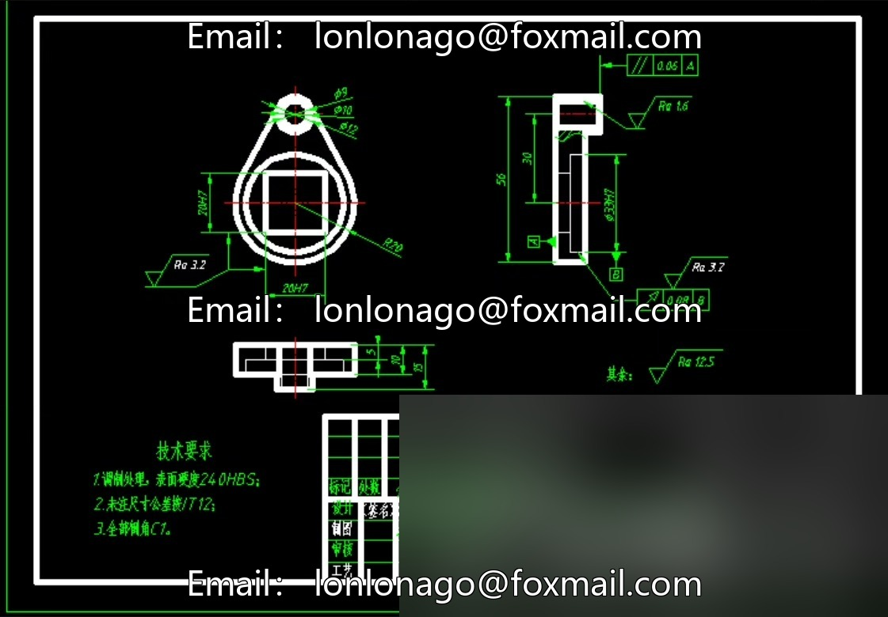
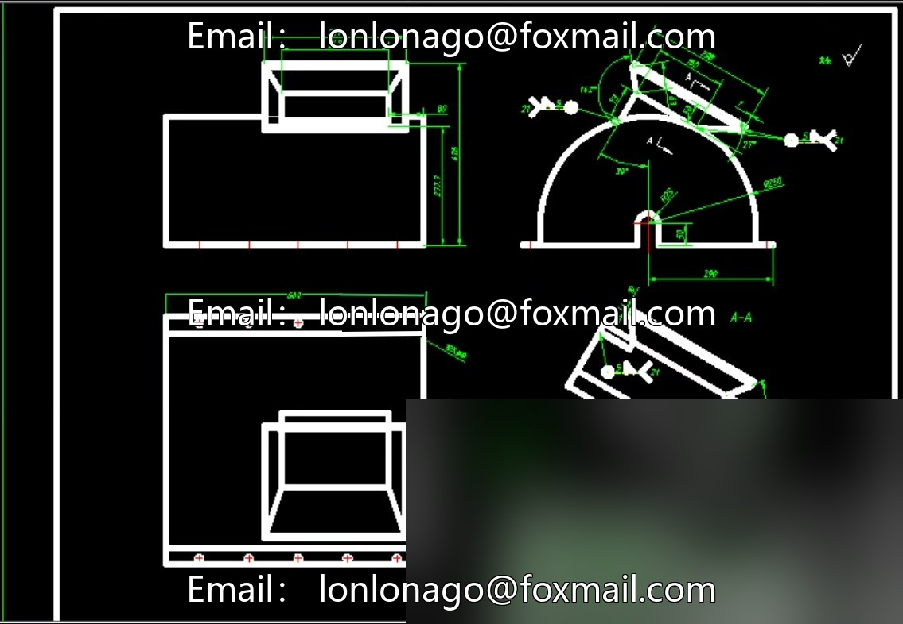
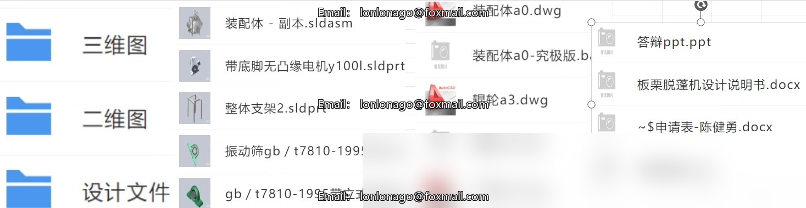

# Board chest peeling machine design diagram; board chest deflating machine design diagram; board chest peeling machine design CAD diagram

## Body

Chestnut defovering machine design drawings; chestnut deflinting machine design drawings; chestnut defovering machine design CAD drawings; chestnut deflinting machine design CAD drawings
86 The drive belt of this design is driven by the motor, realizing the operation of main working parts, stick, vibration screen, and winder. The chestnut husk undergoes striking by the stick, friction with the bucket wall, and self friction to defover the chestnut, and after defovering, chestnuts and outer husks are dropped by the mesh cage to the vibration screen, which separates chestnut nuts and chestnut husks

The design covers the board-cushion deshelling machine's design, CAD drawings, assembly parts, product illustration and design explanation, including belt drive transmission and technical requirements.

<!-- AI_ENRICHED -->

## Images

## Payment

Here is a pay link on Stripe ( https://buy.stripe.com/3cs8yP7sY87d0vu9AB ). Please contact me lonlonago@foxmail.com after funding $89, and I will send you a complete data files , thank you!

